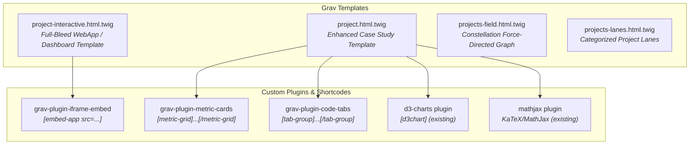
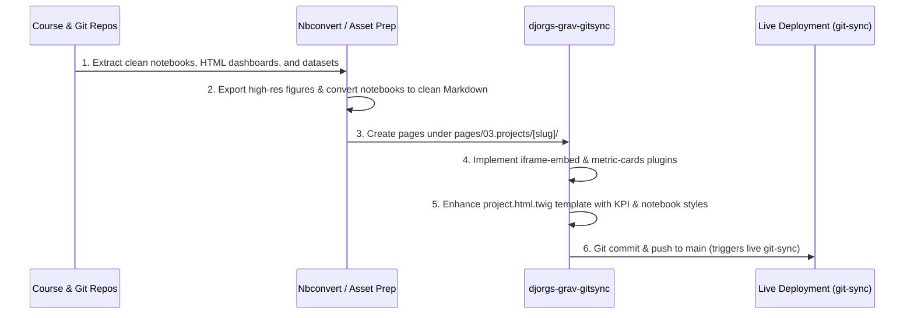

# Comprehensive Plan: Porting 10 Data Science Projects to Portfolio (Grav CMS)

## Executive Overview

This plan establishes an end-to-end strategy to port 10 representative data science projects from academic course materials (`/home/djorgs/Documents/school/datasci-school/`) and standalone repositories (`honey-yield-predictive-model`, `aoe2-coach`) into the Grav-based portfolio website at `/home/djorgs/Documents/git/djorgs-grav-gitsync/`.

Together, these 10 projects span the full lifecycle and spectrum of the modern data science discipline:
- **Production MLOps & Low-Latency Edge Inference**
- **Constrained Optimization & Operations Research**
- **IoT Environmental Sensor Processing & Two-Stage Hurdle Time Series**
- **Econometric Panel Regression, Hydrology & Quantile Risk Analysis**
- **Geospatial Demographics & Multi-Medium Publication Cartography**
- **Operational Analytics & FOIA Rate Standardization**
- **Media Business Intelligence & Viewer Engagement Survival Curves**
- **Information Retrieval & Hybrid Recommender Systems**
- **Multi-Source ETL, Web Scraping & Relational Database Engineering**
- **Non-Parametric Statistical Inference & Municipal Big Data**
- **Combinatorial Probability & Enterprise Business Intelligence (DAX / Power BI)**

---

## User Review Required

> [!IMPORTANT]
> **Delivery Format Strategy for Interactive Artifacts**: Several projects feature large, rich interactive outputs (e.g., the 3.4 MB Folium Leaflet map for *The Second Rent*, the Chart.js dashboard for *Netflix*, the 9-slide HTML deck for *TSA*, and the Next.js app for *AoE2 Coach*). This plan proposes sandboxed iframe embeds with responsive height control and full-screen expansion toggles, rather than trying to flatten them into static markdown images or inline their CSS/JS directly into the `finals` theme.

> [!IMPORTANT]
> **Proprietary & Binary File Formats**: The *Lottery* project relies on Microsoft Power BI Desktop (`Lottery.pbix`). Because Grav cannot execute `.pbix` files directly on Linux, this plan proposes showcasing the project via an interactive visual case study with pre-rendered report layouts, data pipeline architecture diagrams, and formatted DAX/M measure blocks.

---

## 1. Selected 10 Projects & Technical Coverage

Below are the 10 recommended projects selected to cover a wide swath of technical competencies.

```mermaid
graph TD
    subgraph Machine Learning & Production AI
        P1["1. AoE2 Tactical & Strategic AI Coach<br><i>MLOps, ONNX sub-2ms, Linear Programming</i>"]
        P2["2. Honey Bee Colony Weight Dynamics<br><i>IoT Sensors, Two-Stage Hurdle, DuckDB</i>"]
        P7["7. MovieLens Hybrid Recommender<br><i>Collaborative Filtering, TF-IDF, Cosine Sim</i>"]
    end

    subgraph Econometrics, Statistics & Risk
        P3["3. Utah Watershed Availability & Data Centers<br><i>Panel FE, Spatial Hydrology, Quantile Reg</i>"]
        P9["9. NYC Urban Forest Canopy & Health<br><i>Permutation Testing, PMF/CDF, Random Forest</i>"]
        P10["10. Lottery Odds Degradation Analysis<br><i>Combinatorial Probability, DAX, Power Query</i>"]
    end

    subgraph Data Engineering & Operations
        P8["8. Broadway Stage-to-Film Pipeline<br><i>Web Scraping, REST APIs, SQLite 3NF</i>"]
        P5["5. TSA Checkpoint Screening Operations<br><i>FOIA Processing, Rate Standardization, USWDS</i>"]
    end

    subgraph Visualization & Analytics
        P4["4. The Second Rent: Childcare Affordability<br><i>County-Level Choropleth, Folium, Design System</i>"]
        P6["6. Netflix Global Content Longevity<br><i>Survival Curves, Chart.js Dashboard, BI</i>"]
    end
```

### Project Descriptions

| # | Proposed Portfolio Title | Primary Domain | Technical Methodology / Stack | Source Location |
|---|---|---|---|---|
| **1** | **RTS Tactical & Strategic AI Coach: Low-Latency Inference & Economic Optimization** | Real-Time Esports / Gaming | ONNX Runtime (<2ms P99), Linear Programming (`scipy.optimize.linprog`), Multi-Target Regression, Logistic Classification, FastAPI, Next.js 15, Docker, Kubernetes | `/home/djorgs/Documents/git/aoe2-coach/` |
| **2** | **Honey Bee Colony Sensor Analytics: Two-Stage Hurdle Time Series Modeling** | Precision Agritech / IoT Ecology | DuckDB SQL ETL, ERA5 Weather API Reanalysis, LightGBM/CatBoost Hurdle Architecture (Classification + Regression), Temporal Block CV, Skill Benchmarking | `/home/djorgs/Documents/git/honey-yield-predictive-model/` |
| **3** | **Utah Watershed Hydrology: Econometric Panel Regression & Data Center Water Demand** | Spatial Hydrology & Resource Economics | USGS NWAA Panel Data, HUC12 Watershed Spatial Joins, Fixed-Effects Demeaning, GroupKFold Block CV, Quantile Regression ($\tau=0.10$ tail-risk), Cluster-Robust SEs | `/home/djorgs/Documents/school/datasci-school/550/term-project/` |
| **4** | **The Second Rent: Geospatial Mapping of U.S. County Childcare Affordability** | Public Policy / Demographic Economics | National Database of Childcare Prices (NDCP), Census Income Data, CPI-U Normalization, Folium/Leaflet County Choropleth Map, Custom Multi-Medium Design System | `/home/djorgs/Documents/school/datasci-school/640/term-project/` |
| **5** | **TSA Passenger Screening Operations: FOIA Data Normalization & Executive Briefing** | Public Aviation Operations | FOIA Unstructured Data Munging, FAA Enplanement Volume Matching, Complaints per Million Boardings Metric, U.S. Web Design System (`tsa_uswds`) 9-Slide HTML Deck | `/home/djorgs/Documents/school/datasci-school/640/tsa/` |
| **6** | **Streaming Content Longevity: Survival Analysis & Netflix Top 10 Executive Dashboard** | Media & Entertainment BI | 146 Weeks Global Viewership (94 Countries), Film vs. TV Survival/Decay Curves, Interactive Chart.js KPI Dashboard, Content Acquisition Strategy | `/home/djorgs/Documents/school/datasci-school/640/netflix-top-10/` |
| **7** | **MovieLens Hybrid Recommendation Engine: Collaborative Filtering & TF-IDF Blending** | Information Retrieval / E-Commerce | Adjusted-Cosine Item Similarity with Shrinkage, TF-IDF Genre/Tag NLP Vectors, Rank Min-Max Normalization, Leave-One-Out Evaluation with Sampled Negatives, Rating Lift | `/home/djorgs/Documents/school/datasci-school/630/Week10/` |
| **8** | **Broadway Stage-to-Film Adaptation Pipeline: Web Scraping, REST APIs & SQLite** | Entertainment Analytics & Data Engineering | BeautifulSoup Wikipedia Scraping, Regex Data Cleaning, IMDB REST API Ingestion, 3NF SQLite Relational Modeling, Complex SQL Joins & Window Aggregations | `/home/djorgs/Documents/school/datasci-school/540/project/` |
| **9** | **NYC Urban Forest Canopy: Non-Parametric Hypothesis Testing & Vitality Classification** | Municipal Big Data / Urban Forestry | 683,000+ NYC Tree Census Records, Probability Mass/Cumulative Distribution Functions (PMF/CDF), Permutation Testing, Bivariate Correlation, Random Forest Classifier | `/home/djorgs/Documents/school/datasci-school/530/djorgensen_530_final-project.ipynb` |
| **10** | **State Lottery Odds Degradation: Longitudinal Combinatorial & DAX Modeling** | Applied Probability / Consumer Finance | Power Query M Multi-Schema ETL, Dynamic Matrix Pool Estimation, Combinatorial Jackpot Probability ($C(n,k)$ in DAX), Power BI Dashboard of Regressive Mechanics | `/home/djorgs/Documents/school/datasci-school/640/lottery/` |

*(Note: If an additional classical statistical forecasting project is desired, **DSC 630 Week 8 - US Retail Sales SARIMA Time Series Forecasting** stands as a ready alternate covering Box-Jenkins stationarity testing, ADF tests, seasonal differencing, and Ljung-Box residual diagnostics).*

---

## 2. Audit of Broken and Non-Working Elements

As instructed, this section strictly documents what is broken, failing, missing, or fragile across the 10 projects without implementing fixes.

### 1. RTS Tactical & Strategic AI Coach (`aoe2-coach`)
- **Input Dimension Mismatch in ONNX Model**: `MLInferenceService.get_recommendation()` compiles and passes a feature array of 76 dimensions (`Got: 76`), but the exported ONNX model artifact (`models/artifacts/strategy_classifier.onnx`) expects exactly 65 dimensions (`Expected: 65`).
- **Test Suite Failures**: 8 tests fail and 10 tests raise errors across `test_api.py`, `test_calibration_and_benchmarks.py`, `test_ml_inference_service.py`, `test_prompt_builder.py`, `test_explanation_engine.py`, and `test_hallucination_verifier.py` due to the dimension mismatch and unhandled mock states.
- **FastAPI TestClient Deprecation**: Starlette deprecation warning raised during test execution due to `httpx` vs `httpx2` compatibility in `fastapi.testclient`.

### 2. Honey Bee Colony Weight Dynamics (`honey-yield-predictive-model`)
- **Missing Milestone Deliverable**: The root `README.md` instructs users to execute `jupyter nbconvert --to html --execute Milestone_5.ipynb`, but `Milestone_5.ipynb` does not exist in the repository root. Only `Milestone_4.ipynb`, `Milestone_4_alt.ipynb`, `Milestone_Final.ipynb`, and a generator script `scripts/make_milestone_5_notebook.py` exist.
- **Tailscale & Remote Credential Dependency**: `scripts/pull_source_snapshot.py` fails unless connected to a private Tailscale network and supplied with an uncommitted `.env` file containing DuckDB remote credentials.
- **Untracked Working Artifacts**: `Final_Paper_Figures/` directory and `Honey_Yield_Final_Paper.docx` remain untracked in git status.

### 3. Utah Watershed Hydrology & Data Centers (`550/term-project/`)
- **Stray Unrendered Notebook in Portfolio Repo**: `david-jorgensen_550_Project_Final.ipynb` was copied raw into the root of `djorgs-grav-gitsync/` rather than being processed into a published Grav page.
- **Broken Internal Navigation Anchors**: The notebook contains internal markdown cross-references (such as `[Writeup section](#writeup)`) that fail to resolve when rendered outside of a Jupyter environment.
- **Unsynced Data Dependencies**: Relies on multi-megabyte external files in `550/term-project/data/` (USGS NWAA, Cleanview geocoded data) that are absent from the web repository.

### 4. The Second Rent: Childcare Affordability (`640/term-project/`)
- **Hardcoded Sibling Directory Path**: `secondrent.py` line 22 contains `FONTS = ROOT.parent / "tsa" / "fonts"`, binding the project execution to the sibling folder `640/tsa/`. Running `secondrent.py` in isolation fails with a missing path error.
- **Heavy Inlined GeoJSON**: `secondrent_map.html` is 3.4 MB containing all 3,144 US county boundaries inlined into JavaScript, causing browser stutter and blocking main thread rendering if embedded directly without deferred loading.
- **Broken Relative Asset Links**: HTML mediums (`medium01_infographic.html`, `medium02_map.html`, `medium03_brief.html`) load figures via `../figures/m01_bullet.png`, which break if opened from a single web route or relocated directory.

### 5. TSA Passenger Screening Operations (`640/tsa/`)
- **Template Layout Collision**: `tsa_checkpoint_briefing.html` is a 1.6 MB standalone slide deck with fixed viewport styling, slide controllers, and hardcoded inline CSS that cannot be pasted into Grav's default article layout without destroying the site header/footer.
- **Source Data Disaggregation Deficit**: 43% of complaints in the source FOIA dataset lack an airport identifier, which causes queries grouped by airport to drop nearly half of all national complaints.

### 6. Netflix Top 10 Streaming Longevity (`640/netflix-top-10/`)
- **External CDN Dependency Without Integrity Fallback**: `netflix_films_vs_tv_dashboard.html` links directly to `https://cdnjs.cloudflare.com/ajax/libs/Chart.js/4.4.1/chart.umd.min.js` without an SRI hash or local offline fallback.
- **Leftover Office Lock File**: Stale temporary file `.~lock.Netflix_Films_vs_TV_Briefing.docx#` remains in the working directory.
- **Canvas Viewport Overflow**: The dashboard uses hardcoded canvas container heights (`340px`, `420px`) and desktop-specific two-column grid layouts that produce horizontal overflow on screens below 820px.

### 7. MovieLens Hybrid Recommender System (`630/Week10/`)
- **Blocking Interactive Terminal Prompt**: Step 11 (`Interactive input`) calls Python's native `input()` function, causing non-interactive batch runs (e.g. `nbconvert --execute`) to hang indefinitely.
- **Conflicting Deliverable Artifacts**: The directory contains competing versions of output files (`david-jorgensen_DSC630_week10.html`, `david-jorgensen_DSC630_week10_v2.html`, and `.pdf`) with differing cell outputs.

### 8. Broadway Stage-to-Film Adaptation Pipeline (`540/project/`)
- **Fragile Unofficial Third-Party API**: `david-jorgensen_540_final.ipynb` hardcodes `BASE_URL = "https://api.imdbapi.dev"`, an unofficial free API without authentication or uptime guarantees. Clearing `imdb_cache.json` or `film_first_cache.json` causes live execution to fail if the API endpoint is unavailable.
- **Ephemeral Database Instance**: SQLite operations are performed against a transient database connection rather than generating a persistent, committed `.db` or `.sqlite` file in the repo.

### 9. NYC Urban Forest Canopy & Health (`530/djorgensen_530_final-project.ipynb`)
- **Missing Source Data Directory**: Notebook execution attempts to read from `./final-project-data/` (`new_york_tree_census_1995.csv`, `2005.csv`, `2015.csv`), but `./final-project-data/` does not exist on disk, completely preventing notebook reproduction.
- **No Exported Deliverables**: Unlike other course modules, no HTML or PDF pre-rendered report exists; only the raw uncompiled `.ipynb` is saved.

### 10. State Lottery Odds Degradation (`640/lottery/`)
- **Proprietary Desktop-Only Binary**: The primary artifact is `Lottery.pbix`, a binary Microsoft Power BI format that cannot be viewed, rendered, or interacted with inside Linux or an open-source web browser.
- **Inaccessible Authenticated SharePoint Monikers**: `TRANSFORMATIONS.md` documents Power Query M scripts hardcoded to a private Bellevue University OneDrive/SharePoint tenant (`https://bellevueuniversity-my.sharepoint.com/personal/djorgensen_my365_bellevue_edu`), rendering the M script un-refreshable for outside evaluators.

---

## 3. Improved Naming & Documentation Conventions

### The Problem with Existing Naming
Current project directories and files use academic course codes, personal student names, and submission milestones:
- `david-jorgensen_540_final.ipynb`
- `david-jorgensen_550_Project_Final.ipynb`
- `david-jorgensen_DSC630_week10_v2.ipynb`
- `david-jorgensen_640_week4.ipynb`
- `Milestone_4_alt.ipynb`
- `500 - Exercise 6 - KMeans.docx`

To hiring managers, clients, and recruiters, these names obscure technical competency and domain context.

### Proposed Naming Convention
Every project will be indexed under a standard dual-identity format:
$$\textbf{[Domain / Subject Matter]} : \textbf{[Data Science Methodology / Architecture]}$$

For website routing and repositories, clean lowercase kebab-case slugs will be used:
$$\texttt{[domain-subject]-[primary-method]}$$

### Mapping: Current vs. Proposed

| # | Current File / Directory Name | Proposed Professional Portfolio Title | Proposed Grav Page Slug |
|---|---|---|---|
| **1** | `aoe2-coach` | **RTS Tactical & Strategic AI Coach: Low-Latency Inference & Economic Optimization** | `rts-tactical-ai-coach` |
| **2** | `honey-yield-predictive-model` | **Honey Bee Colony Sensor Analytics: Two-Stage Hurdle Time Series Modeling** | `honeybee-sensor-hurdle-model` |
| **3** | `550/term-project` (`david-jorgensen_550_Project_Final`) | **Utah Watershed Hydrology: Econometric Panel Regression & Data Center Water Demand** | `watershed-hydrology-panel-econometrics` |
| **4** | `640/term-project` (`The Second Rent`) | **The Second Rent: Geospatial Mapping of U.S. County Childcare Affordability** | `childcare-affordability-second-rent` |
| **5** | `640/tsa` (`tsa_checkpoint_briefing.html`) | **TSA Passenger Screening Operations: FOIA Data Normalization & Executive Briefing** | `tsa-checkpoint-operational-analytics` |
| **6** | `640/netflix-top-10` (`netflix_films_vs_tv_dashboard`) | **Streaming Content Longevity: Survival Analysis & Netflix Top 10 Executive Dashboard** | `netflix-streaming-retention-dashboard` |
| **7** | `630/Week10` (`david-jorgensen_DSC630_week10`) | **MovieLens Hybrid Recommendation Engine: Collaborative Filtering & TF-IDF Blending** | `hybrid-movielens-recommender` |
| **8** | `540/project` (`david-jorgensen_540_final`) | **Broadway Stage-to-Film Adaptation Pipeline: Web Scraping, REST APIs & SQLite** | `broadway-film-etl-pipeline` |
| **9** | `530/djorgensen_530_final-project.ipynb` | **NYC Urban Forest Canopy: Non-Parametric Hypothesis Testing & Vitality Classification** | `nyc-urban-forest-vitality` |
| **10** | `640/lottery` (`Lottery.pbix`) | **State Lottery Odds Degradation: Longitudinal Combinatorial & DAX Modeling** | `lottery-odds-combinatorial-dax` |

---

### Standardized 6-Section Case Study Documentation Structure

Every project ported to Grav will follow a uniform technical case study structure:

1. **Executive Briefing & Problem Framing**: Real-world business, scientific, or policy context. What was the central question, and what was the core decision supported?
2. **Data Engineering & Provenance**: Raw data sources, sampling grains, volume, schema reconciliation, and privacy/licensing considerations.
3. **Mathematical Formulation & Methodology**: Algorithms used, statistical loss functions, formal mathematical notation (LaTeX/MathJax), and architectural reasoning.
4. **Validation Strategy & Empirical Results**: Baseline comparisons (e.g. skill over naive baseline, popularity lift), cross-validation strategy (GroupKFold, temporal splits), and residual diagnostics.
5. **Interactive Demonstration & Visual Deliverable**: Responsive embedded application, interactive Leaflet map, Chart.js dashboard, or high-resolution figure gallery.
6. **Production Architecture & Technical Meta**: Tech stack badges, reproducible command-line instructions, links to GitHub repositories, and environment specifications.

---

## 4. Grav Website Architecture: Needed Templates & Plugins

The target website is powered by Grav CMS with the custom `finals` theme (`themes/finals/`). Pushing to `main` deploys changes live via `git-sync`.

### 4.1 Required Theme Templates (`themes/finals/templates/`)



#### 1. Enhanced `project.html.twig`
The current `project.html.twig` is a minimal template that dumps raw markdown into `<article class="art-body">`. For data science case studies, it requires:
- **Executive KPI Metric Strip**: Renders frontmatter key-value metrics (e.g., `accuracy: "+15.2%"`, `latency: "<2ms P99"`, `dataset_size: "683k rows"`).
- **Sub-Navigation Sticky Table of Contents**: Automatically highlights sections (`Problem`, `Data`, `Methodology`, `Validation`, `Architecture`).
- **Jupyter Notebook Output Styling**: CSS rules to handle notebook-style tables (`dataframe`), blockquotes, and code output blocks cleanly without breaking container widths.
- **Two-Column Methodology Callouts**: For pairing code snippets with natural language takeaways side-by-side.

#### 2. New `project-interactive.html.twig` (Dedicated Full-Bleed / Application Template)
Several projects include rich standalone applications (*The Second Rent* map, *Netflix* dashboard, *TSA* deck, *AoE2 Coach*). This template provides:
- A distraction-free presentation header with project metadata and a "Back to Case Study" toggle.
- A responsive viewport container for the interactive app with an expansion/fullscreen toggle button.
- An expandable bottom drawer or tabbed drawer containing the technical methodology and data documentation.

#### 3. Updates to `projects-lanes.html.twig` and `projects-field.html.twig`
- Configure `weight` frontmatter values (1 to 10) so the 10 data science projects scale prominently in the constellation force graph.
- Add technical methodology tags to the interactive filter pills (`MLOps`, `Econometrics`, `Geospatial`, `Time Series`, `NLP`, `BI & Dashboards`).

---

### 4.2 Needed Grav Plugins & Shortcodes

To properly showcase data science work, the following Grav plugins are needed (custom plugin creation in `plugins/` is supported by Grav):

#### 1. `iframe-embed` Plugin (New Plugin: `plugins/iframe-embed/`)
- **Purpose**: Safely embed self-contained deliverables (`secondrent_map.html`, `netflix_films_vs_tv_dashboard.html`, `tsa_checkpoint_briefing.html`) directly inside Grav pages.
- **Shortcode Syntax**:
  ```markdown
  [embed-app src="secondrent_map.html" height="650px" title="County Affordability Map" allowfullscreen="true" /]
  ```
- **Capabilities**:
  - Automatically wraps iframe in a responsive container with aspect ratio preservation.
  - Injects `loading="lazy"` and secure `sandbox` attributes (`allow-scripts allow-same-origin`).
  - Adds a "View Fullscreen" icon button in the upper-right corner.

#### 2. `metric-cards` Plugin (New Plugin: `plugins/metric-cards/`)
- **Purpose**: Render executive-level stat boxes and KPI metric grids at the top of case studies.
- **Shortcode Syntax**:
  ```markdown
  [metric-grid]
    [metric value="+15.2%" label="Skill Over Naive" delta="Weekly Grain" /]
    [metric value="<2ms" label="Inference Latency" delta="P99 ONNX" /]
    [metric value="3,144" label="Counties Analyzed" delta="100% US Coverage" /]
  [/metric-grid]
  ```
- **Visuals**: Matches site theme CSS variables (`--ink`, `--panel`, accent colors) with high-contrast typography.

#### 3. `code-tabs` Plugin (New Plugin: `plugins/code-tabs/`)
- **Purpose**: Enable toggling between model iterations, code vs. output, or SQL vs. Python implementations.
- **Shortcode Syntax**:
  ```markdown
  [tab-group]
    [tab title="SQL Pipeline"]
      ```sql
      SELECT hive_id, date, weight_delta FROM honey_daily ...
      ```
    [/tab]
    [tab title="LightGBM Model"]
      ```python
      lgb.train(params, train_set, num_boost_round=500)
      ```
    [/tab]
  [/tab-group]
  ```

#### 4. Existing Plugins to Leverage:
- **`d3-charts`**: Already installed in `plugins/d3-charts/`. Provides inline SVG interactive charts via `[d3chart]` shortcode for lightweight interactive charts.
- **`mathjax`**: Already installed in `plugins/mathjax/`. Renders LaTeX formulas for loss functions, objective functions, and statistical equations.
- **`prism-highlight`**: Already installed in `plugins/prism-highlight/`. Powers code block syntax highlighting.
- **`mermaid-diagrams`**: Already installed in `plugins/mermaid-diagrams/`. Generates pipeline and system architecture flowcharts.
- **`shortcode-citation`**: Already installed in `plugins/shortcode-citation/`. Formats academic references for literature and data sources.

---

## 5. Implementation & Migration Steps



### Proposed Changes Summary

#### Component 1: Theme Templates & Styling (`themes/finals/`)
- [MODIFY] `themes/finals/templates/project.html.twig`: Add KPI strip support, responsive embed container, notebook table styling, and metadata layout.
- [NEW] `themes/finals/templates/project-interactive.html.twig`: Full-bleed container template for client-side web applications and dashboards.
- [MODIFY] `themes/finals/css/projects.css`: Add styles for metric cards, notebook cell layouts, iframe wrappers, and fullscreen modals.

#### Component 2: Custom Grav Plugins (`plugins/`)
- [NEW] `plugins/iframe-embed/`: Plugin providing `[embed-app]` shortcode with lazy-loading, sandboxing, and fullscreen overlay.
- [NEW] `plugins/metric-cards/`: Plugin providing `[metric-grid]` and `[metric]` shortcodes for executive KPI callouts.
- [NEW] `plugins/code-tabs/`: Plugin providing `[tab-group]` and `[tab]` shortcodes for side-by-side code/output comparisons.

#### Component 3: Project Pages (`pages/03.projects/`)
Create 10 dedicated project folders containing the Markdown case study, hero image, and bundled interactive assets:
- [NEW] `pages/03.projects/rts-tactical-ai-coach/`
- [NEW] `pages/03.projects/honeybee-sensor-hurdle-model/`
- [NEW] `pages/03.projects/watershed-hydrology-panel-econometrics/`
- [NEW] `pages/03.projects/childcare-affordability-second-rent/`
- [NEW] `pages/03.projects/tsa-checkpoint-operational-analytics/`
- [NEW] `pages/03.projects/netflix-streaming-retention-dashboard/`
- [NEW] `pages/03.projects/hybrid-movielens-recommender/`
- [NEW] `pages/03.projects/broadway-film-etl-pipeline/`
- [NEW] `pages/03.projects/nyc-urban-forest-vitality/`
- [NEW] `pages/03.projects/lottery-odds-combinatorial-dax/`

#### Component 4: Housekeeping
- [DELETE] `david-jorgensen_550_Project_Final.ipynb` (stray uncompiled notebook in root of `djorgs-grav-gitsync/`).

---

## Verification Plan

### Automated Verification
1. **Grav Page Collection & Routing**:
   ```bash
   # Verify Grav page compilation and frontmatter parsing
   php bin/grav clear-cache
   ```
2. **Twig Template Linting**:
   ```bash
   # Test Twig templates for syntax validity
   find themes/finals/templates -name "*.twig" -exec php -l {} \;
   ```
3. **Shortcode & Plugin Validation**:
   - Verify `iframe-embed` renders clean HTML without PHP notices.
   - Verify `metric-cards` properly applies responsive grid flexbox CSS.

### Manual Verification
1. **Visual UI Inspection**:
   - Test `pages/03.projects/` in desktop, tablet, and mobile viewports.
   - Ensure the constellation force graph in `pages/03.projects/explore/` displays all 10 projects with appropriate node sizes.
   - Test interactive embed toggles for *The Second Rent* map, *Netflix* dashboard, and *TSA* deck in full-screen and standard views.
2. **Performance & Memory Profiling**:
   - Verify that lazy-loading prevents the 3.4 MB Leaflet map from blocking initial page paint.
   - Check that MathJax renders all mathematical formulations cleanly without raw LaTeX escaping bugs.
